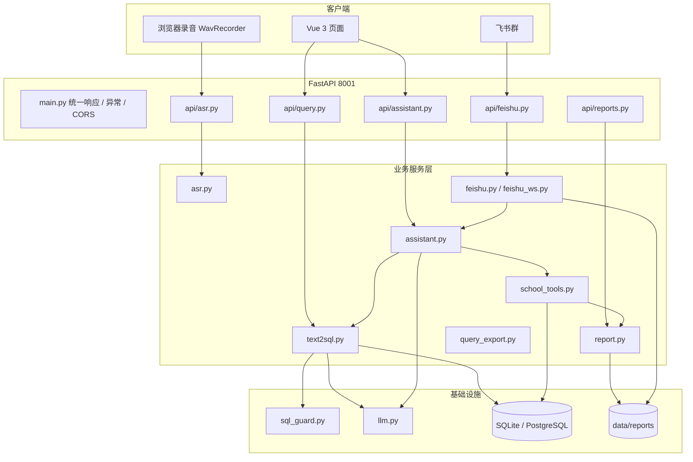
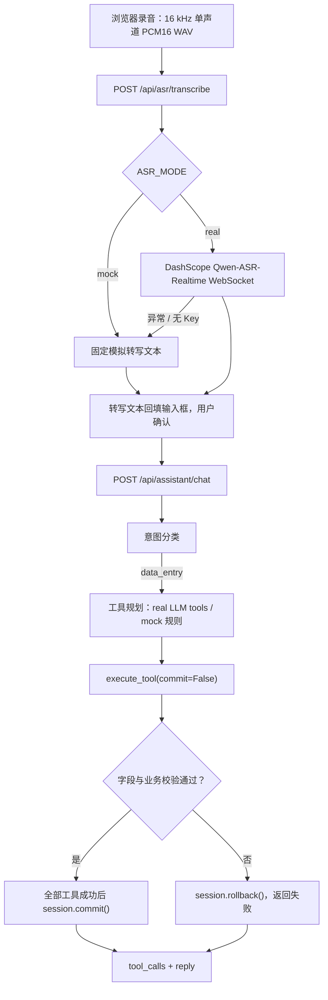
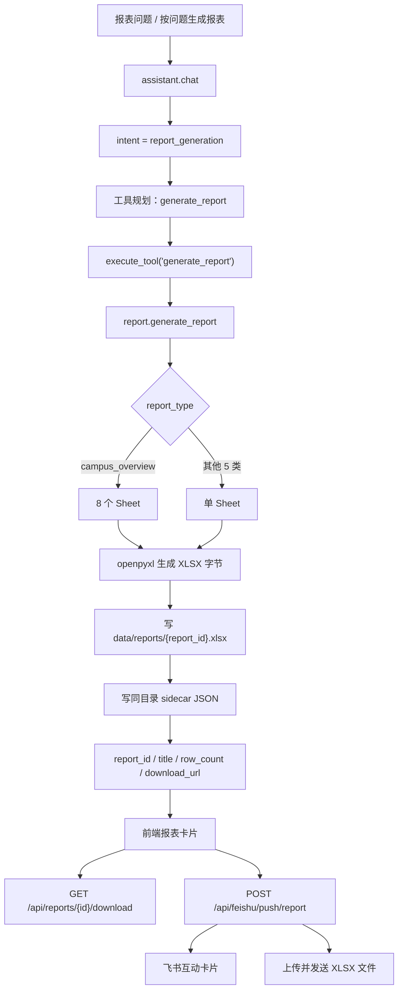
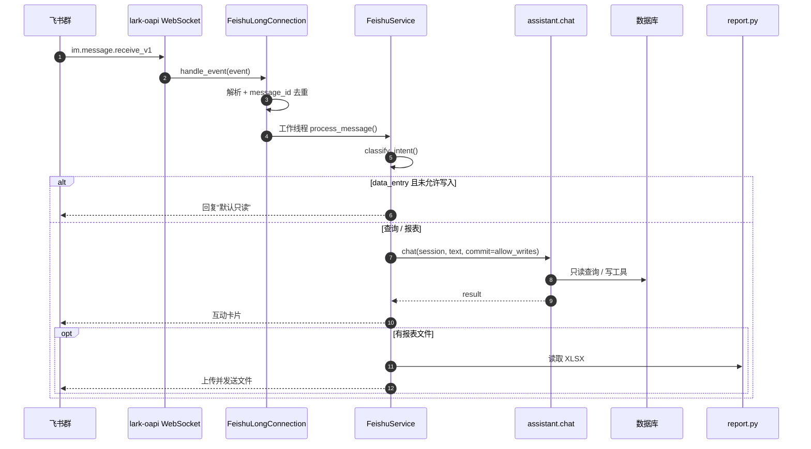

# 校园数据问答项目：三大功能、数据流转与技术栈

> 项目路径：`D:\Project\smartdeck_prepgenius`
>
> 本文按当前代码实现整理，描述三个业务功能、完整数据链路、技术栈、关键模块与运行方式。
>
> 当前验收基线：后端 `pytest` 87 项通过，前端 `npm run build` 通过。

---

## 1. 项目定位

这是一个**校园数据自然语言问答（Text2SQL）**应用：

- 用户在网页输入一句中文问题，或说一段语音；
- 后端完成语音转写、意图识别，然后走两条路：
  - **只读查询**：生成 SQL，经过安全校验后在数据库中执行；
  - **Function Call**：调用内部工具完成数据录入或报表生成；
- 返回结果表、ECharts 图表、中文结论、写入结果或可下载的 XLSX 报表；
- 支持把报表推送到飞书群。

数据库严格只有 8 张业务表，无登录、无用户体系、无角色权限。

### 1.1 三个业务功能

项目里的“三类事情”与助手提示语一致：

| 编号 | 功能 | 典型问题 | 核心链路 |
|---|---|---|---|
| 1 | **查数据** | “上周八年级各班出勤率” | 意图 `data_query` → Text2SQL → 只读 SQL → 结果表 / 图表 / 中文结论 |
| 2 | **录数据** | “给李雷登记今天的正常考勤” | 语音或文本 → 意图 `data_entry` → Function Call → 事务写入 8 张业务表 |
| 3 | **出报表** | “生成八年级出勤报表” | 意图 `report_generation` → `generate_report` → XLSX → 下载 / 飞书推送 |

> 语音转写和飞书机器人是**横跨三个功能的输入/输出通道**，不单独算第四类业务功能：
>
> - 语音可以把问题转成文本，再走查数据、录数据、出报表；
> - 飞书群可以复用同一套助手完成问数与报表推送，但默认只读。

### 1.2 功能与通道矩阵

| 功能 | 网页文本 | 网页语音 | 飞书群 |
|---|---|---|---|
| 查数据 | 支持 | 支持 | 支持 |
| 录数据 | 支持 | 支持（转写后需用户确认） | 默认拒绝写操作 |
| 出报表 | 支持 | 支持 | 支持，卡片 + XLSX 文件 |

---

## 2. 总体架构



### 2.1 分层职责

| 层 | 目录 | 职责 |
|---|---|---|
| 接口层 | `backend/app/api/` | 只处理 HTTP 参数、依赖注入、统一响应；不直接拼 SQL |
| 业务层 | `backend/app/services/` | Text2SQL、意图与工具编排、ASR、报表、导出、飞书 |
| 核心层 | `backend/app/core/` | 数据库连接、SQL 安全、LLM 网关、提示词、配置、异常 |
| 模型层 | `backend/app/models/school.py` | 只定义 8 张业务表 |
| 数据模型 | `backend/app/schemas/` | 请求与响应 Pydantic 模型 |
| 前端 | `frontend/src/` | Vue 3 页面、REST 封装、录音、ECharts |

---

## 3. 技术栈

### 3.1 前端

| 技术 | 版本 / 说明 | 用途 |
|---|---|---|
| Vue 3 | `3.5.44` | 页面与响应式状态 |
| TypeScript | `5.9.3` | 类型检查 |
| Vite | `7.3.7` | 开发服务器与生产构建 |
| Element Plus | `2.14.7` | 输入框、按钮、表格、消息提示 |
| `@element-plus/icons-vue` | `2.3.2` | 图标 |
| ECharts | `^5.6.0` | 柱状图 / 折线图 |
| vue-tsc | `3.3.14` | `vue-tsc --noEmit` 类型检查 |
| Web Audio API | 浏览器内置 | 麦克风采集、重采样、WAV 编码 |
| ResizeObserver | 浏览器内置 | 图表自适应容器尺寸 |

前端没有路由、没有 Pinia、没有登录页，`App.vue` 直接渲染 `views/query/index.vue`。

### 3.2 后端

| 技术 | 版本 / 说明 | 用途 |
|---|---|---|
| Python | `>=3.12` | 运行时 |
| FastAPI | `>=0.115` | HTTP 接口与依赖注入 |
| Uvicorn | `>=0.30` | ASGI 服务，默认端口 8001 |
| SQLAlchemy | `>=2.0` | ORM、会话、事务 |
| Pydantic | `>=2.8` | 请求 / 响应模型 |
| pydantic-settings | `>=2.4` | 读取 `.env` 配置 |
| httpx | `>=0.27` | OpenAI 兼容 LLM 调用 |
| sqlglot | `>=27.0` | SQL 解析、白名单校验、方言转译 |
| openpyxl | `>=3.1` | XLSX 生成与样式 |
| websockets | `>=15` | DashScope ASR WebSocket 客户端 |
| cryptography | `>=42` | 飞书回调 AES-256-CBC 解密 |
| lark-oapi | `>=1.7.5` | 飞书长连接 WebSocket 客户端 |
| python-multipart | `>=0.0.9` | 接收语音文件上传 |
| psycopg[binary] | `>=3.2` | PostgreSQL 驱动 |
| pytest | `>=8.0` | 后端测试 |

### 3.3 数据与 AI 服务

| 能力 | 实现 |
|---|---|
| 主数据库 | 默认 SQLite `data/p1.db`；设置 `P1_DATABASE_URL` 后切换 PostgreSQL |
| Text2SQL 大模型 | OpenAI 兼容 `/chat/completions`，默认模型 `deepseek-chat`，可配置 `api_key`、`base_url`、`model_name` |
| 语音转写 | DashScope Qwen-ASR-Realtime，默认模型 `qwen3-asr-flash-realtime`，WebSocket 流式转写 |
| 飞书 | 飞书开放平台，`lark-oapi` 长连接 + 消息 API；可选 HTTP 事件回调 |
| 离线模式 | `LLM_MODE=mock`、`ASR_MODE=mock`、`FEISHU_MODE=mock` 完全不发起外部网络请求 |

### 3.4 测试与构建

| 命令 | 作用 |
|---|---|
| `python -m pytest backend/tests -q` | 后端 87 项测试 |
| `cd frontend; npm run build` | `vue-tsc --noEmit` + `vite build` |
| `python scripts/generate_campus_report.py --json` | 命令行生成校园数据总览模板报表 |

---

## 4. 端到端数据流总览

### 4.1 一条请求经过哪些层

```text
浏览器输入 / 录音
      │
      ▼
Vue 3 页面（index.vue）
      │  fetch JSON / multipart
      ▼
FastAPI 路由（api/*.py）
      │  Pydantic 校验
      ▼
业务服务（services/*.py）
      │
      ├── Text2SQL：问题 → SQL → sqlglot 校验 → 只读执行
      ├── Function Call：意图 → 工具计划 → 工具校验 → 事务提交 / 回滚
      └── 报表：报表类型 + 范围 + 日期 → ORM 查询 → openpyxl → 文件
      │
      ▼
统一响应 {code, message, data, trace_id}
      │
      ▼
Vue 3：结果表 / ECharts 图表 / 中文结论 / 报表卡片 / 导出
```

### 4.2 请求与响应外壳

所有 JSON 接口使用统一响应：

```json
{
  "code": 0,
  "message": "ok",
  "data": {},
  "trace_id": "..."
}
```

- `code=0` 表示成功；
- 参数校验失败返回 HTTP 422，内部码 `1001`；
- 业务异常由 `main.py` 统一转换为统一响应；
- 助手接口会移除服务器绝对路径 `file_path`，只返回 `download_url`。

### 4.3 数据形态变化

| 阶段 | 数据形态 | 示例 |
|---|---|---|
| 用户输入 | 字符串 / 音频 Blob | `"上周八年级各班出勤率"` |
| 语音转写 | PCM16 WAV → 文本 | `"上周八年级各班出勤率"` |
| 意图分类 | 意图 JSON | `{"intent":"data_query","confidence":1.0,"reason":"..."}` |
| 工具规划 | 工具名 + 参数 | `{"name":"generate_report","arguments":{"report_type":"attendance_summary","target":"八年级"}}` |
| SQL | SQL 字符串 | `SELECT ... FROM attendance ...` |
| SQL 安全 | 校验后的 SQL | 单条 SELECT、白名单、`LIMIT 200`、目标方言 |
| 数据库 | 行 / 元组 | `[("八年级一班", 98.5), ...]` |
| 结果构造 | columns / rows / chart / answer | JSON 结构 |
| 页面渲染 | 表格 / 图表 / 文本 | Element Plus 表格 + ECharts |
| 报表 | XLSX 字节 + sidecar JSON | `data/reports/{report_id}.xlsx` |
| 飞书 | 卡片 + 文件 | 互动卡片 + `file_key` |

### 4.4 接口到服务映射

| 接口 | 路由文件 | 主要服务 | 是否写库 |
|---|---|---|---|
| `GET /api/health` | `main.py` | 无 | 否 |
| `GET /api/query/meta` | `api/query.py` | `text2sql.get_meta` | 否 |
| `POST /api/query/nl` | `api/query.py` | `text2sql.answer_question` | 否，只读 |
| `POST /api/query/export` | `api/query.py` | `query_export.build_export` | 否 |
| `GET /api/assistant/meta` | `api/assistant.py` | `assistant.get_meta` | 否 |
| `POST /api/assistant/chat` | `api/assistant.py` | `assistant.chat` | 查询否；录入是 |
| `POST /api/asr/transcribe` | `api/asr.py` | `asr.transcribe` | 否 |
| `GET /api/reports/{report_id}/download` | `api/reports.py` | `report.resolve_report` | 否 |
| `POST /api/feishu/events` | `api/feishu.py` | `feishu.parse_callback` / `process_message` | 查询否；允许写入时是 |
| `POST /api/feishu/push/report` | `api/feishu.py` | `feishu.push_report` | 否 |
| `GET /api/feishu/meta` | `api/feishu.py` | `feishu.meta` | 否 |

---

## 5. 功能一：查数据（自然语言问数 / Text2SQL）

### 5.1 数据流

```mermaid
flowchart LR
    Q["用户问题"] --> UI["Vue ask()"]
    UI --> API["POST /api/assistant/chat"]
    API --> INTENT["assistant.classify_intent"]
    INTENT -->|"data_query"| T2S["text2sql.answer_question"]
    T2S --> MODE{"LLM_MODE"}
    MODE -->|"mock"| TPL["关键词匹配内置模板"]
    MODE -->|"real"| LLM["LLM 生成 JSON：sql / explanation / chart / title"]
    LLM -->|"校验或执行失败，最多 2 次"| LLM
    LLM -->|"最终失败"| TPL
    TPL --> GUARD["sql_guard.validate_sql"]
    LLM --> GUARD
    GUARD --> EXEC["只读执行：SQLite / PostgreSQL"]
    EXEC --> BUILD["构造 columns / rows / chart / answer"]
    BUILD --> RESP["统一响应"]
    RESP --> UI2["结果表 + ECharts + 中文结论 + SQL"]
```



### 5.2 处理步骤

1. **前端提交**
   - `views/query/index.vue` 的 `ask()` 去掉首尾空格；
   - 调用 `api/assistant.ts` 的 `chatWithAssistant()`；
   - 请求体为 `{ "question": "...", "force_report": false }`；
   - 页面统一走 `/api/assistant/chat`，`/api/query/nl` 保留为直接问数接口。

2. **意图识别**
   - `assistant.classify_intent()` 把问题分为四类：
     - `data_query`：查询、统计、排名、名单、联系方式等只读问题；
     - `data_entry`：新增学生/家长、录入考勤、提交请假、录入课程表；
     - `report_generation`：生成或导出报表；
     - `chitchat`：问候、帮助说明、无关问题。
   - mock 模式使用关键词规则；
   - real 模式让 LLM 输出意图 JSON，失败时回退关键词规则并标记 `degraded`。

3. **进入 Text2SQL**
   - `assistant.chat()` 对 `data_query` 调用 `text2sql.answer_question(session, question)`；
   - 查询结果写入响应字段 `query`。

4. **mock 模式：模板匹配**
   - `_mock_template()` 按关键词选择内置模板；
   - 覆盖出勤率、迟到排行、学生出勤、待审批请假、请假名单、课程表、家长联系方式、人数统计、班主任、教师课时等问法；
   - 每个模板提供 `sql`、`title`、`explanation`、`chart`、`answer`；
   - 无法识别时返回澄清提示与示例问题，`need_clarification=true`。

5. **real 模式：LLM 生成 SQL**
   - `_build_messages()` 把 8 表结构摘要、字段说明、示例问法放进提示词；
   - `LLMGateway.complete()` 调用 OpenAI 兼容 `/chat/completions`；
   - 模型返回 JSON：`sql`、`explanation`、`chart`、`title`；
   - 最多尝试 2 次；第一次校验或执行失败时，把错误和上一次 SQL 回填给模型重试；
   - 仍失败则回退内置模板，并标记 `degraded=true`、`model_mode="mock"`。

6. **SQL 安全校验**
   - `_run_sql()` 先调用 `core/sql_guard.py` 的 `validate_sql()`：
     - 只允许单条 SQL；
     - 只允许 `SELECT`；
     - 拒绝 `INSERT / UPDATE / DELETE / DROP / ALTER / PRAGMA / ATTACH / VACUUM / CREATE / TRUNCATE` 等；
     - 拒绝注释；
     - 表名、列名来自 8 个 ORM 模型动态生成的白名单；
     - 拒绝未知表、未知别名、未知列；
     - 拒绝 `SELECT *`；
     - 没有 `LIMIT` 或 `LIMIT > 200` 时自动补 `LIMIT 200`；
     - 作者方言固定 SQLite，按目标库转译为 PostgreSQL，并把占位符改写为 SQLAlchemy 的 `:name` 形式。

7. **只读执行**
   - `execute_readonly()` 按数据库类型分流：
     - SQLite：`PRAGMA query_only=ON`，设置 progress handler，超过 3 秒中断；
     - PostgreSQL：只读事务 `SET TRANSACTION READ ONLY`，`SET LOCAL statement_timeout = 3000`；
     - 最多取 201 行，用于判断是否截断，最终最多返回 200 行。

8. **构造结果**
   - `_build_result_rows()`：把数据库行转成 `columns` 与 `rows`，日期、Decimal 等转成 JSON 可序列化值；
   - `_build_chart()`：根据数值列和维度列推断 `bar` / `line` / `table`；
   - `_answer_text()`：优先用模板的回答函数，否则按结果行生成通用中文结论；
   - 所有统计数字来自本次 SQL 结果，模型不参与编造数字。

9. **前端渲染**
   - `agentResult.value = response`；
   - `result.value = response.query`；
   - `chartOption` 根据 `chart.type / chart.x / chart.y` 生成 ECharts 配置；
   - `BaseChart.vue` 负责初始化、`setOption`、`ResizeObserver` 与销毁；
   - 页面展示标题、中文结论、SQL、结果表和图表；
   - 结果可导出 XLSX / CSV。

### 5.3 时间范围与业务口径

- `text2sql.resolve_as_of(session)` 取数据库中**最新的考勤日期**，避免示例数据与系统日期错位；
- 支持今天、昨天、本周、上周、本月、最近 7 天、最近两周；
- 默认最近 30 天；
- 出勤率口径固定为：`出勤率 =（正常 + 迟到）/ 应出勤`；
- 改口径时必须同步模板、提示词与文档。

### 5.4 降级与错误路径

| 场景 | 行为 |
|---|---|
| `LLM_MODE=mock` | 直接用内置模板，完全离线、确定性 |
| real 模式缺少 Key / Base URL | 启动时自动降级 mock，记录原因 |
| real 调用异常 | 本次请求降级 mock，`degraded=true` |
| 模型 SQL 校验失败 | 回填错误重试，最多 2 次 |
| 两次仍失败 | 回退模板，`model_mode="mock"` |
| 模板也匹配不到 | 返回澄清提示与示例问题 |
| SQL 执行超时 | 返回“查询超时（超过 3 秒）” |
| SQL 访问非白名单表/列 | 返回可读的校验错误，不执行 |

### 5.5 查询结果字段

`/api/assistant/chat` 的 `data.query` 与 `/api/query/nl` 的 `data` 结构一致：

| 字段 | 含义 |
|---|---|
| `question` | 原始问题 |
| `title` | 结果标题 |
| `sql` | 本次执行的安全 SQL |
| `explanation` | 口径或查询说明 |
| `columns` | 列定义：`key`、`label`、`type` |
| `rows` | 行数据 |
| `chart` | `{type, x, y, series}` |
| `answer` | 中文结论 |
| `summary` | 摘要 |
| `row_count` | 行数 |
| `elapsed_ms` | 耗时 |
| `need_clarification` | 是否需要澄清 |
| `degraded` | 是否降级 |
| `model_mode` | `real` / `mock` |

---

## 6. 功能二：录数据（语音 / 文本 + Function Call）

### 6.1 数据流



### 6.2 语音转写过程

1. **浏览器采集**
   - `utils/recorder.ts` 的 `WavRecorder` 使用 `navigator.mediaDevices.getUserMedia()`；
   - 单声道、回声消除、噪声抑制；
   - `ScriptProcessorNode` 采集 Float32 PCM；
   - `resample()` 线性重采样到 16 kHz；
   - `encodeWav()` 编码为 16-bit PCM WAV；
   - 音频只在内存中，不落本地磁盘。

2. **上传**
   - 前端 `transcribeAudio()` 用 `FormData` 上传 `audio` 与可选 `language`；
   - 后端 `POST /api/asr/transcribe` 最多读取 8 MB。

3. **后端校验与转码**
   - `wav_to_pcm16()` 校验 WAV 格式、采样率、声道数、时长；
   - 单次语音不能超过 60 秒；
   - 多声道下混为单声道，必要时线性重采样到 16 kHz。

4. **真实转写**
   - `ASRService._transcribe_real()` 连接 DashScope WebSocket；
   - 依次发送：
     - `session.update`；
     - `input_audio_buffer.append`（base64 分片）；
     - `input_audio_buffer.commit`；
     - `session.finish`；
   - 收集 `input_audio_transcription.completed` 事件，拼接最终文本；
   - 失败或未配置 Key 时自动降级 mock，错误信息脱敏后记录。

5. **用户确认**
   - 转写文本只回填输入框，不自动提交；
   - 数据录入属于写操作，必须由用户确认后点击“开始处理”。

### 6.3 意图分类

入口：`assistant.classify_intent()`。

| 意图 | 判定方式（mock） | 典型问题 |
|---|---|---|
| `data_query` | 查询/统计/名单/排名/出勤率等关键词 | 上周八年级各班出勤率 |
| `data_entry` | 录入/新增/提交/登记等动词 + 业务对象 | 给李雷登记今天的正常考勤 |
| `report_generation` | “报表/报告”或“生成 + 花名册/统计表/汇总表”等 | 生成八年级出勤报表 |
| `chitchat` | 问候、帮助、无关问题 | 你好，你是谁 |

real 模式先让 LLM 输出意图 JSON；解析失败或调用失败时回退关键词规则。

### 6.4 工具规划

- **mock 模式**：`plan_mock_tools()` 用确定性规则解析：
  - 学生姓名、教师姓名从数据库中匹配；
  - 班级/年级用正则解析；
  - 日期支持今天、明天、后天、昨天、本周、上周、具体 ISO 日期；
  - 报表类型按关键词选择。
- **real 模式**：`plan_real_tools()` 把 `TOOL_DEFINITIONS` 作为 `tools` 传给模型，由模型返回工具名与参数；失败回退规则规划。

### 6.5 六个内部工具

| 工具 | 作用 | 主要校验 |
|---|---|---|
| `create_student` | 新增学生档案 | 学号唯一、姓名、性别、班级存在 |
| `create_parent` | 为已有学生新增家长 | 学生存在、手机号、重复联系人 |
| `record_attendance` | 录入或更新考勤 | 学生存在、日期、状态、同一学生同一天唯一 |
| `create_leave_request` | 提交待审批请假 | 学生、请假类型、起止日期、天数计算 |
| `create_timetable_entry` | 录入课程表 | 班级、星期、节次、学期组合唯一、教师存在 |
| `generate_report` | 生成 XLSX 报表 | 报表类型、范围、日期；只生成文件，不写数据库 |

所有写工具只操作既有 8 张业务表，不新增报告表、审计表、查询历史表或工具执行记录表。

### 6.6 事务语义

`assistant.chat()` 对工具计划的处理：

```text
for call in plan:
    execute_tool(session, call.name, call.arguments, commit=False)
if all succeeded:
    session.commit()
else:
    session.rollback()
```

- 多个工具在同一事务中执行；
- 任一工具抛出 `ToolError / ValueError / TypeError`，全部回滚；
- 全部成功后才统一提交；
- `generate_report` 只写文件，不参与数据库事务，但会作为工具结果返回。

### 6.7 响应结构

```json
{
  "intent": "data_entry",
  "intent_label": "数据录入",
  "intent_confidence": 1.0,
  "intent_reason": "问题包含录入动词与业务对象",
  "reply": "已为李雷登记 2026-11-04 的正常考勤。",
  "tool_calls": [
    {
      "name": "record_attendance",
      "label": "录入考勤",
      "arguments": {"student_name": "李雷", "status": "正常"},
      "status": "success",
      "summary": "已录入考勤",
      "data": {}
    }
  ],
  "query": null,
  "report": null,
  "degraded": false,
  "model_mode": "real",
  "elapsed_ms": 123
}
```

### 6.8 飞书群里的写入边界

- 飞书群机器人默认只读；
- `data_entry` 意图直接回复“群机器人默认只读，数据录入不会自动执行”；
- 只有 `FEISHU_ALLOW_WRITES=true` 时，才以 `commit=True` 执行写工具；
- 该限制与网页端无关，网页端数据录入由用户明确点击后提交。

---

## 7. 功能三：出报表（XLSX 生成、下载与飞书推送）

### 7.1 数据流



### 7.2 六类报表

| `report_type` | 报表 | 主要数据源 | 说明 |
|---|---|---|---|
| `attendance_summary` | 出勤报表 | `attendance`、`students`、`classes` | 按日期区间统计出勤 |
| `leave_summary` | 请假报表 | `leave_requests`、`students`、`classes` | 按日期区间统计请假 |
| `student_roster` | 学生花名册 | `students`、`classes`、`grades` | 按班级/年级过滤 |
| `timetable` | 课程表 | `timetable`、`classes`、`teachers` | 按班级过滤 |
| `grade_overview` | 年级概况报表 | `grades`、`classes`、`students`、`attendance` | 年级维度汇总 |
| `campus_overview` | 校园数据总览报表 | 全部 8 张业务表 | 每张表一个 Sheet，共 8 个 Sheet |

`campus_overview` 的 8 个 Sheet：

1. 年级概况
2. 教师名录
3. 班级概况
4. 学生花名册
5. 家长联系表
6. 出勤汇总
7. 请假记录
8. 课程表

### 7.3 生成步骤

1. **触发**
   - 用户问“生成八年级出勤报表”等报表问题；
   - 或点击前端“按问题生成报表”按钮，携带 `force_report=true`。

2. **强制报表路径**
   - `POST /api/assistant/chat` 的 `force_report=true` 会跳过意图分类，固定为 `report_generation`；
   - real 模式只保留 `generate_report` 调用；
   - 模型未返回合法报表工具时，回退确定性报表规则，保证一定产出报表；
   - 输入框为空时，前端使用“生成校园数据总览模板报表”。

3. **参数规划**
   - `report_type`：六类之一；
   - `target`：全校 / 年级 / 班级；
   - `start_date`、`end_date`：日期区间，缺省时按报表类型使用最近 30 天或数据最新日期。

4. **生成文件**
   - `report.generate_report()` 按类型调用对应 builder；
   - `query_export.build_xlsx()` 生成单 Sheet XLSX；
   - `query_export.build_multi_sheet_xlsx()` 生成多 Sheet XLSX；
   - 表头深蓝、冻结首行、列宽自适应；
   - `report_id = uuid4().hex`；
   - 文件写入 `data/reports/{report_id}.xlsx`；
   - 同时写 `data/reports/{report_id}.json`，保存 `title`、`filename`、`report_type`、`row_count`、`created_at`、`sheets` 等元数据。

5. **返回**
   - 响应 `report` 字段包含：
     - `report_id`
     - `title`
     - `filename`
     - `row_count`
     - `download_url`
     - `columns` / `rows`
     - `sheets`（仅 `campus_overview`）
   - API 层会移除 `file_path`，不暴露服务器绝对路径。

6. **下载**
   - 前端 `downloadGeneratedReport()` 请求 `GET /api/reports/{report_id}/download`；
   - 后端校验 `report_id` 格式与文件存在性；
   - 通过 `Content-Disposition` 返回中文文件名；
   - 浏览器用 Blob + `<a download>` 保存。

7. **导出查询结果**
   - 这是另一条路径：查询结果导出不调用报表生成器；
   - 前端把当前 `columns`、`rows` 回传给 `POST /api/query/export`；
   - 后端 `query_export.build_export()` 生成 XLSX 或 CSV；
   - CSV 使用 `utf-8-sig`，中文不乱码。

### 7.4 模板报表为什么每次内容相同

`campus_overview` 是固定模板：

- 固定 8 个 Sheet；
- 固定列结构；
- 每次从数据库重新查询；
- 默认日期范围取最新考勤日期往前 30 天。

因此：

- 数据库没变、日期范围没变时，单元格内容完全一致；
- 每次只有 `report_id`、文件名、生成时间不同；
- 数据变化时，数字会更新，但 Sheet 和列结构不变。

### 7.5 飞书推送

网页端报表卡片上的“推送到飞书”按钮：

```text
POST /api/feishu/push/report
{
  "report_id": "...",
  "chat_id": "..."   // 可选；省略时用默认群
}
```

后端流程：

1. `report.resolve_report(report_id)` 找到 XLSX 与 sidecar JSON；
2. 读取标题、行数、文件名；
3. `send_card()` 发送互动卡片；
4. `_upload_file()` 上传 XLSX，得到 `file_key`；
5. `send_message()` 发送文件消息；
6. 返回 `report_id`、`title`、`filename`、`row_count`、`chat_id`、`mode`、`degraded`。

mock 模式不发起网络请求，发送记录只写入进程内存 `mock_outbox`。

---

## 8. 飞书通道：长连接与事件回调

### 8.1 长连接（默认）



关键点：

- `main.py` 的 lifespan 启动守护监听线程；
- `FEISHU_LONG_CONNECTION=false` 可关闭；
- 事件只在 SDK 线程中解析与去重，问答交给独立工作线程；
- 忽略应用自身消息；
- 断线重连由 `lark-oapi` SDK 负责；
- `GET /api/feishu/meta` 返回：
  - `long_connection`：`disabled / starting / running / error / stopped`；
  - `long_connection_connected`：WebSocket 是否已建立。

### 8.2 HTTP 事件回调（可选）

`POST /api/feishu/events`：

1. 读取原始请求体；
2. 校验签名：`sha256(timestamp + nonce + encrypt_key + raw_body)`；
3. 配置了加密时，用 AES-256-CBC 解密 `encrypt`；
4. 校验 `verification_token`；
5. URL 校验请求原样返回 `challenge`；
6. 消息事件去重后交给 `process_message()`；
7. 校验失败返回 403。

### 8.3 去重与模式

- 长连接与回调共用同一个 `FeishuService`；
- `message_id` 内存去重，TTL 1 小时；
- 模式为 `auto | real | mock`：
  - `auto` 缺应用凭据时走 mock；
  - `real` 缺凭据或 `FEISHU_MODE=mock` 时走 mock；
  - mock 不启动长连接、不发起网络请求；
  - mock 发送记录只存在内存 `mock_outbox`。

### 8.4 安全边界

- `FEISHU_APP_SECRET`、`FEISHU_VERIFICATION_TOKEN`、`FEISHU_ENCRYPT_KEY` 只存在本地 `.env`；
- `/api/feishu/meta`、日志、错误信息不返回这些值或片段；
- 不新增飞书消息、会话、推送记录或审计表；
- 群机器人默认只读。

---

## 9. 数据模型与访问边界

### 9.1 严格 8 张业务表

| 表 | 说明 | 关键字段 |
|---|---|---|
| `grades` | 年级 | `name`、`level`、`sort` |
| `teachers` | 教师 | `teacher_no`、`name`、`gender`、`subject`、`title`、`phone`、`hire_date` |
| `classes` | 班级 | `grade_id`、`name`、`head_teacher_id`、`classroom` |
| `students` | 学生 | `student_no`、`name`、`gender`、`birth_date`、`grade_id`、`class_id`、`status` |
| `parents` | 家长 | `student_id`、`name`、`relation`、`phone`、`occupation`、`is_primary` |
| `attendance` | 出勤 | `student_id`、`class_id`、`date`、`status`、`check_in_time`、`remark` |
| `leave_requests` | 请假 | `student_id`、`class_id`、`leave_type`、`start_date`、`end_date`、`days`、`status` |
| `timetable` | 课程表 | `class_id`、`weekday`、`period`、`subject`、`teacher_id`、`semester` |

种子数据使用固定随机种子 `20261103` 与固定学期（2026-09-01 至 2026-11-03），生成：

- 3 个年级
- 24 名教师
- 6 个班级
- 180 名学生
- 360 条家长记录
- 8,280 条考勤
- 60 条请假
- 180 条课程表记录

张小明固定在八年级一班，李雷固定在八年级二班。

### 9.2 读路径与写路径

| 路径 | 入口 | 数据访问 |
|---|---|---|
| 读 | Text2SQL / 报表生成 | 只读 SQL 或 ORM `SELECT`，不修改数据 |
| 写 | Function Call 写工具 | 只操作 8 张业务表，事务提交/回滚 |
| 文件 | 报表生成 | 只写 `data/reports/`，不写数据库表 |

### 9.3 不允许出现的表

不得出现第 9 张业务表，包括但不限于：

- 用户表、角色表、权限表；
- 会话表、查询历史表；
- 审计表、工具执行记录表；
- 报告表、消息表、推送记录表。

报表元数据写在 `data/reports/{report_id}.json`，不入库。

---

## 10. 配置与运行

### 10.1 配置来源

- 根目录 `config.py` 是唯一配置源，使用 pydantic-settings 读取 `.env`；
- `backend/config.py` 通过 importlib 按路径加载根配置，解决从 `backend/` 启动时的模块名冲突；
- `backend/app/core/config.py` 只做转发；
- `.env` 只保留在本地，未被 Git 跟踪；仓库只提交 `.env.example` 占位符。

主要配置项：

| 配置 | 作用 |
|---|---|
| `P1_DATABASE_URL` | 留空 → SQLite `data/p1.db`；填写 `postgresql://...` → PostgreSQL |
| `LLM_MODE` | `auto / real / mock` |
| `api_key`、`base_url`、`model_name` | OpenAI 兼容 LLM 配置 |
| `ASR_MODE` | `auto / real / mock` |
| `ASR_API_KEY`、`ASR_BASE_URL`、`ASR_MODEL_NAME` | DashScope 语音转写配置 |
| `FEISHU_MODE` | `auto / real / mock` |
| `FEISHU_APP_ID`、`FEISHU_APP_SECRET` | 飞书应用凭据 |
| `FEISHU_VERIFICATION_TOKEN`、`FEISHU_ENCRYPT_KEY` | HTTP 回调验签与解密 |
| `FEISHU_DEFAULT_CHAT_ID` | 默认推送群 |
| `FEISHU_ALLOW_WRITES` | 群机器人是否允许写操作，默认 `false` |
| `FEISHU_LONG_CONNECTION` | 是否启用长连接，默认 `true` |

### 10.2 启动命令

```powershell
# 后端（8001）
cd backend
$env:LLM_MODE = "mock"
python -m uvicorn app.main:app --reload --port 8001

# 前端（5171）
cd frontend
npm install
npm run dev
```

打开 <http://localhost:5171>，无需登录。前端通过 `VITE_API_BASE`（默认 `http://localhost:8001`）访问后端。

### 10.3 离线演示

断网并设置：

```dotenv
LLM_MODE=mock
ASR_MODE=mock
FEISHU_MODE=mock
```

可以完成：

```text
语音转写 → 意图识别 → 提问 / 录入 / 报表
→ 结果表 / 图表 / 中文结论 / 下载
→ 飞书 mock 推送 → 导出
```

mock 模式不发起任何外部网络请求，同一问题 / 同一音频结果稳定可复现。

---

## 11. 关键设计取舍

1. **严格 8 表**
   - 业务边界清晰，Text2SQL 白名单简单可靠；
   - 报表、消息、审计等数据不落库，避免表膨胀。

2. **SQLite 作为 SQL 作者方言**
   - 模板与提示词只写一套 SQL；
   - 执行前由 sqlglot 转译 PostgreSQL；
   - 避免两套数据库各写一套 SQL。

3. **sqlglot 防御纵深**
   - 单条 SELECT；
   - 表/列白名单；
   - 禁注释、禁写、禁 `SELECT *`；
   - 自动 `LIMIT 200`；
   - 即使模型生成了危险 SQL，也无法执行。

4. **确定性 mock**
   - 无 Key、断网也能演示；
   - 测试不依赖外部服务；
   - 同一问题结果稳定。

5. **自动降级**
   - LLM / ASR / 飞书任一真实服务异常，都回退 mock 并标记 `degraded`；
   - 页面不因外部服务不可用而无法使用。

6. **Function Call 事务化**
   - 多工具 `commit=False` 执行；
   - 全部成功才提交；
   - 任一失败全部回滚。

7. **报表文件化**
   - XLSX 与 sidecar JSON 存在 `data/reports/`；
   - 不新增报告表；
   - 下载接口只读文件。

8. **通道复用**
   - 网页、语音、飞书都复用 `assistant.chat()`；
   - 查询、录入、报表逻辑只有一套；
   - 飞书只增加消息收发与文件上传。

9. **中文与编码**
   - 界面、回答、图表标签、导出内容均为中文；
   - CSV 使用 `utf-8-sig`；
   - XLSX 表头与内容不乱码。

---

## 12. 验收与测试

### 12.1 后端

```powershell
python -m pytest backend/tests -q
```

当前结果：**87 passed**。

覆盖范围包括：

- 8 表结构与种子数据；
- SQL 安全校验、白名单、LIMIT、方言转译；
- mock / real 问数；
- 意图分类；
- Function Call 与事务回滚；
- 强制按问题生成报表（`force_report`）；
- ASR mock；
- 报表生成、下载、8 Sheet 总览与范围过滤；
- 飞书长连接事件转换、去重、只读；
- 飞书签名 / 加密；
- mock 推送与上游权限错误回显。

### 12.2 前端

```powershell
cd frontend
npm run build
```

当前结果：**通过**（`vue-tsc --noEmit` + `vite build`）。

### 12.3 端到端验收

断网且三个模式均为 `mock` 时，可完成：

```text
语音转写 → 意图识别 → 提问 / 录入 / 报表
→ 结果表 / 图表 / 中文结论 / 下载
→ 飞书 mock 推送 → 导出
```

PostgreSQL 下：

- 8 表结构与行数与 SQLite 一致；
- 问数、写工具、报表与飞书推送接口可正常执行。

---

## 13. 关键模块地图

| 文件 | 作用 |
|---|---|
| `backend/app/main.py` | FastAPI 入口、CORS、统一异常、lifespan、飞书长连接启动 |
| `backend/app/api/query.py` | `/api/query/nl`、`/api/query/meta`、`/api/query/export` |
| `backend/app/api/assistant.py` | `/api/assistant/chat`、`/api/assistant/meta` |
| `backend/app/api/asr.py` | `/api/asr/transcribe` |
| `backend/app/api/reports.py` | `/api/reports/{id}/download` |
| `backend/app/api/feishu.py` | 飞书事件回调、报表推送、状态 |
| `backend/app/services/text2sql.py` | Text2SQL 模板、提示词、执行与结果构造 |
| `backend/app/services/assistant.py` | 意图分类、工具规划、事务编排 |
| `backend/app/services/school_tools.py` | 6 个内部工具与参数校验 |
| `backend/app/services/report.py` | 6 类 XLSX 报表生成与解析 |
| `backend/app/services/query_export.py` | 单 Sheet XLSX / 多 Sheet XLSX / CSV |
| `backend/app/services/asr.py` | WAV 校验、重采样、DashScope WebSocket、mock |
| `backend/app/services/feishu.py` | 飞书消息、卡片、文件、签名解密、mock |
| `backend/app/services/feishu_ws.py` | 飞书长连接监听与事件分发 |
| `backend/app/core/sql_guard.py` | SQL 白名单、只读校验、LIMIT、方言转译 |
| `backend/app/core/llm.py` | OpenAI 兼容 LLM 网关与降级 |
| `backend/app/core/db.py` | Engine、Session、SQLite/PostgreSQL 切换 |
| `backend/app/core/prompts.py` | 版本化提示词加载 |
| `backend/app/models/school.py` | 8 张业务表模型 |
| `backend/app/seed/seed.py` | 固定种子示例数据 |
| `frontend/src/views/query/index.vue` | 问答页、报表卡片、导出、录音交互 |
| `frontend/src/api/http.ts` | 统一 REST 封装与错误处理 |
| `frontend/src/api/query.ts` | 问数、元数据、导出接口 |
| `frontend/src/api/assistant.ts` | 助手、ASR、报表下载接口 |
| `frontend/src/utils/recorder.ts` | 麦克风采集、16 kHz 重采样、WAV 编码 |
| `frontend/src/components/BaseChart.vue` | ECharts 生命周期与 ResizeObserver |
| `scripts/generate_campus_report.py` | 命令行生成校园数据总览报表 |
| `.claude/skills/campus-report/SKILL.md` | Claude Code 项目技能：重复生成模板报表 |

---

## 14. 附录：请求与响应示例

### 14.1 问数

```text
POST /api/assistant/chat
Content-Type: application/json

{"question": "上周八年级各班出勤率"}
```

响应（节选）：

```json
{
  "code": 0,
  "message": "ok",
  "data": {
    "intent": "data_query",
    "intent_label": "数据查询",
    "reply": "上周八年级各班出勤率如下……",
    "query": {
      "title": "上周八年级各班出勤率",
      "sql": "SELECT ... LIMIT 200",
      "columns": [
        {"key": "班级", "label": "班级", "type": "string"},
        {"key": "出勤率", "label": "出勤率", "type": "number"}
      ],
      "rows": [
        {"班级": "八年级一班", "出勤率": 98.5}
      ],
      "chart": {
        "type": "bar",
        "x": "班级",
        "y": ["出勤率"],
        "series": [{"name": "出勤率", "key": "出勤率"}]
      },
      "answer": "上周八年级各班出勤率：八年级一班 98.5%……",
      "row_count": 2,
      "degraded": false,
      "model_mode": "real"
    },
    "report": null,
    "degraded": false,
    "model_mode": "real",
    "elapsed_ms": 856
  },
  "trace_id": "..."
}
```

### 14.2 录入

```text
POST /api/assistant/chat
Content-Type: application/json

{"question": "给李雷登记今天的正常考勤"}
```

响应（节选）：

```json
{
  "code": 0,
  "message": "ok",
  "data": {
    "intent": "data_entry",
    "intent_label": "数据录入",
    "reply": "已为李雷登记今天的正常考勤。",
    "tool_calls": [
      {
        "name": "record_attendance",
        "label": "录入考勤",
        "status": "success",
        "summary": "已录入考勤",
        "arguments": {"student_name": "李雷", "status": "正常"}
      }
    ],
    "query": null,
    "report": null
  },
  "trace_id": "..."
}
```

### 14.3 报表

```text
POST /api/assistant/chat
Content-Type: application/json

{"question": "生成校园数据总览模板报表", "force_report": true}
```

响应（节选）：

```json
{
  "code": 0,
  "message": "ok",
  "data": {
    "intent": "report_generation",
    "intent_label": "报表生成",
    "reply": "生成全校校园数据总览报表，共 789 行。报表已生成，可直接下载。",
    "tool_calls": [
      {
        "name": "generate_report",
        "label": "生成报表",
        "arguments": {
          "report_type": "campus_overview",
          "target": "",
          "start_date": "",
          "end_date": ""
        },
        "status": "success"
      }
    ],
    "report": {
      "report_id": "…",
      "title": "全校校园数据总览报表（2026-10-05 至 2026-11-03）",
      "filename": "全校校园数据总览报表（2026-10-05 至 2026-11-03）.xlsx",
      "row_count": 789,
      "download_url": "/api/reports/…/download",
      "sheets": [
        {"name": "年级概况", "row_count": 3},
        {"name": "教师名录", "row_count": 24}
      ]
    },
    "query": null,
    "degraded": false,
    "model_mode": "real"
  },
  "trace_id": "..."
}
```

> 示例中的行数取决于当前数据库与日期范围，仅用于说明响应结构。

---

## 15. 一句话总结

**Vue 3 收集问题/语音 → FastAPI 校验并分发 → assistant 做意图识别与工具规划 → 查数走 Text2SQL + sqlglot 安全校验 + 只读执行，录数走 Function Call + 事务，出报表走 ORM 查询 + openpyxl 文件 → 统一 JSON 响应回前端渲染表格/图表/结论/下载；飞书和语音作为通道复用同一套业务链路。**
